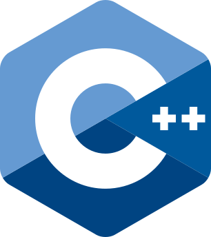
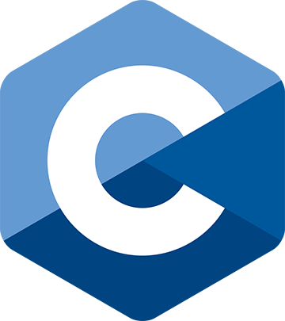
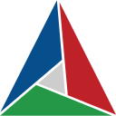
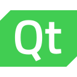
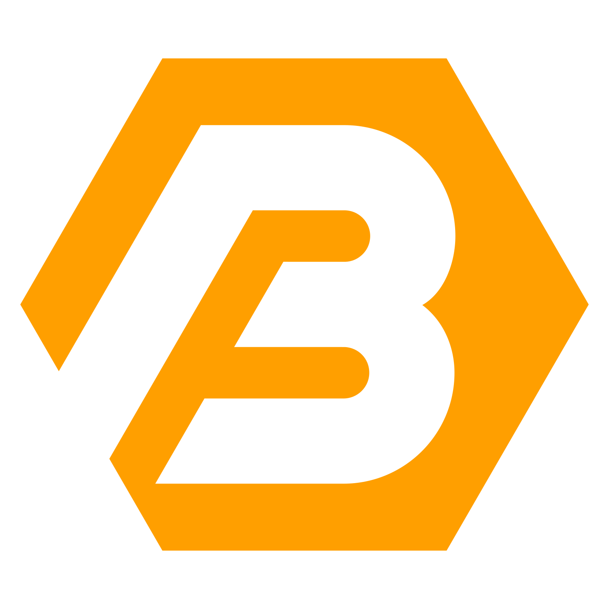
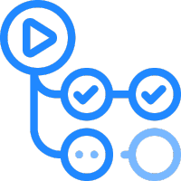
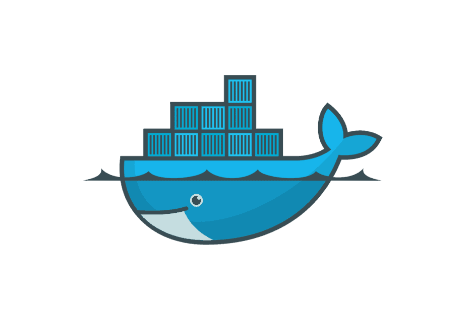
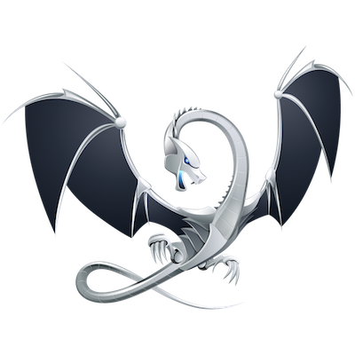
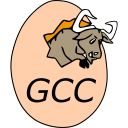
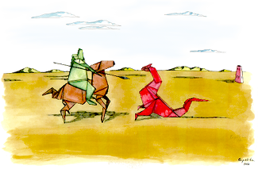

# Hi there 👋 I'm Mateusz

**About me:**

* 🔭 I'm a C++ software engineer who is interested in cross-platform development, compilers, build systems and tooling.
* 🤝 I'm open to C++ related opportunities.
* 👯 I'm looking to collaborate on something interesting in the C++ area.
* 📬 You can reach me through [e-mail](mailto:matpatyk@gmail.com) and [LinkedIn](https://www.linkedin.com/in/mateusz-patyk1/?locale=en_US).
* ❤️ Personally, I'm a fan of real-time strategy games.

**Projects I built:**

* [HET - Household Expenses Tracker](https://het.com.pl/en/) - a free, privacy-first household budget app with no account, no ads and no trackers, where data stays on the device. Includes an AI receipt scanner that turns a photo of a receipt into categorized expenses.

**Recorded live presentations I made:**

* [How to ensure quality in a project and not go crazy? Clang-Format, Clang-Tidy, Cppcheck](https://www.youtube.com/watch?v=Rr8SEU5hemU) at the Gdańsk Embedded Meetup [in Polish].

**Articles and tutorials I wrote:**

* [Protocol Buffers in memory-constrained embedded systems](https://dzone.com/articles/what-are-protocol-buffers) on DZone - sharing my experience as a software engineer in a project that required Protocol Buffers on a memory-constrained embedded system.
* [Qt course for robotics / embedded engineers](https://forbot.pl/blog/kurs-qt-1-czym-jest-qt-pierwsza-aplikacja-w-praktyce-id35549) on Forbot [in Polish].
* [3 tools every programmer should know](https://forbot.pl/blog/3-narzedzia-ktore-powinien-znac-kazdy-programista-id45594) on Forbot - discussing Clang-Format, Cppcheck and Valgrind [in Polish].
* [Compilers from the ground up](https://forbot.pl/forum/topic/19885-kompilatory-od-podszewki-1-wprowadzenie/) on Forbot - a comprehensive four-part series covering compilers, linkers, build automation and a practical example of AVR programming from the console [in Polish].

**I'm skilled in:**

